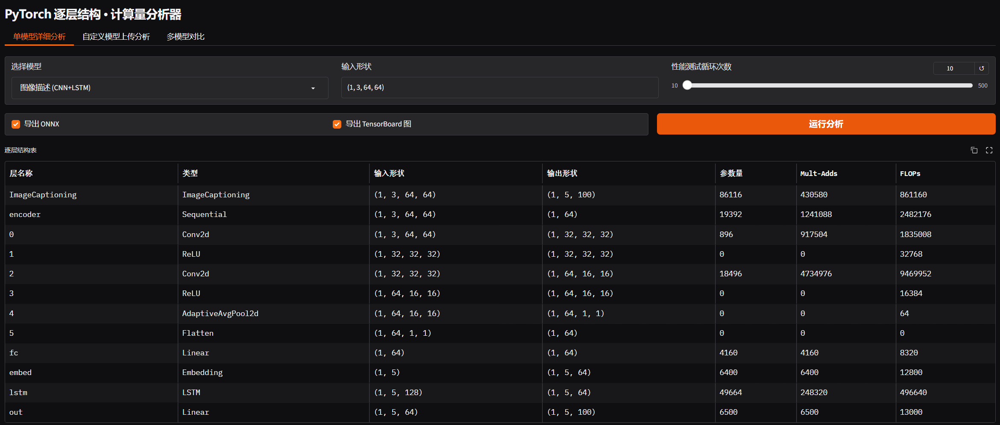
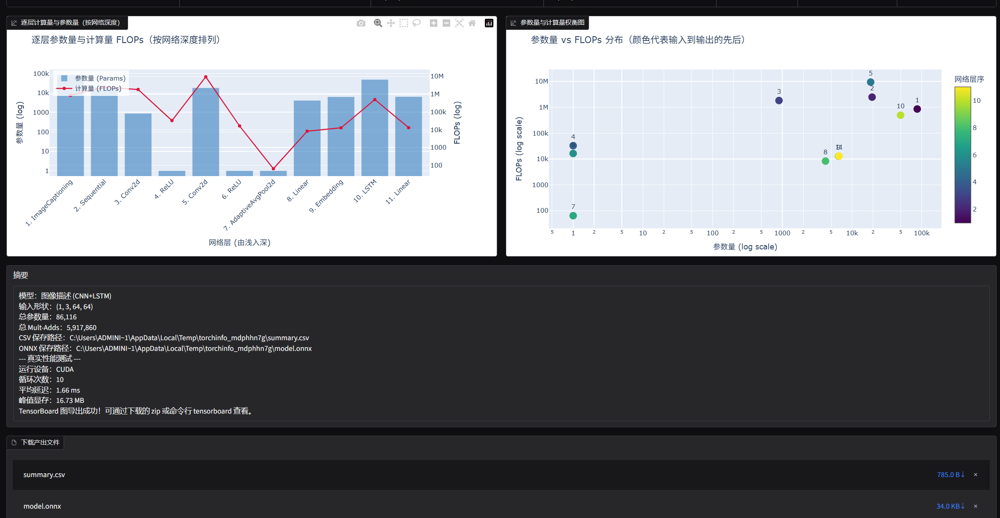
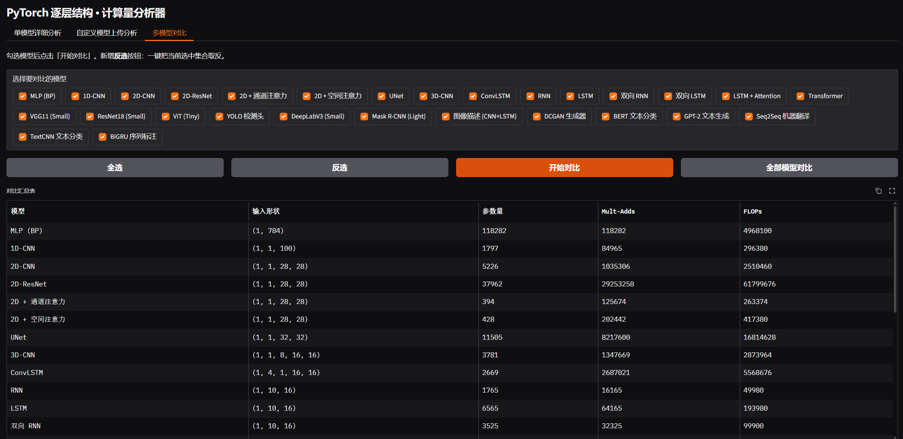
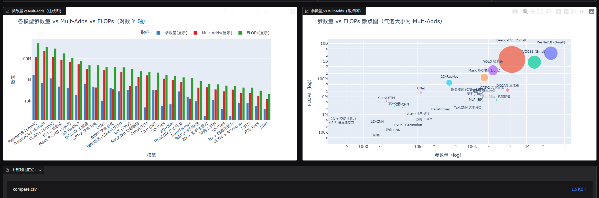
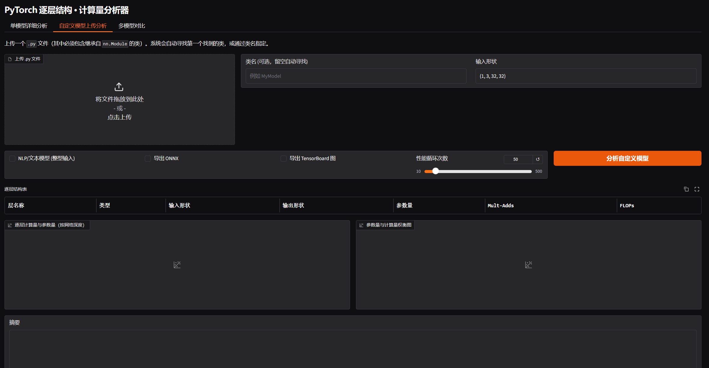
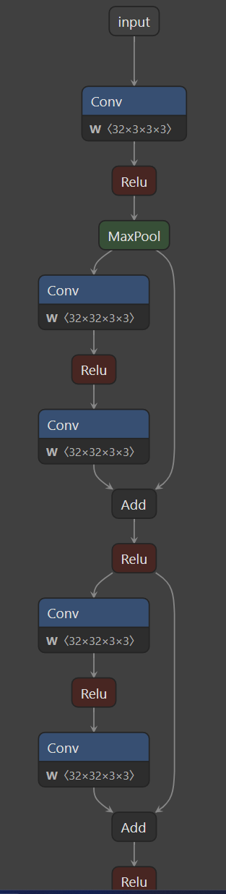

# 🚀 TorchLens — PyTorch Model Anatomy & Visualization Workbench

> **从“看见”到“看清”** —— 一站式解析深度学习模型的参数量、计算量 (MACs/FLOPs)、真实硬件性能、ONNX 拓扑图及 TensorBoard 计算图。支持 30+ 内置主流模型与**自定义模型动态上传分析**。

## 📖 项目简介

在深度学习研究与部署（特别是移动端/端侧 AI 开发）中，我们经常需要回答这样一个问题：**“我设计的这个网络到底有多大？跑得有多快？瓶颈在哪？”**

`print(model)` 只能告诉你有哪些层，而本工具不仅能清晰地展示**每一层的输入/输出形状、参数量、乘加数 (Mult-Adds) 以及包含激活层的完整浮点运算量 (FLOPs)**，还能横向对比不同架构（CNN、RNN、Transformer等）的差异。它不仅能输出结构化表格，还能生成直观的双 Y 轴图、权衡散点图，甚至一键导出可供 Netron 查看的 ONNX 图和供 TensorBoard 查看的计算图。

## ✨ 核心功能

- 📊 **单模型逐层精细分析**：
  - 自动解析逐层输入/输出张量形状。
  - 统计每层参数量 (Params) 与乘加数 (Mult-Adds)。
  - **独创 FLOPs 补全**：填补了传统 `torchinfo` 无法统计激活层、池化层、归一化层计算量的空白。
  - **实测性能 Profiler**：在真实设备（CPU/GPU）上测试平均延迟 (Latency) 与峰值显存 (VRAM)。
- 📈 **多模型横向对比**：
  - 内置 30+ 涵盖 CV/NLP 领域的流行架构（含目标检测、图像分割、文本生成等）。
  - 一键生成柱状图（对比 Params/MACs/FLOPs）与散点图（分析容量与计算量的权衡）。
- 🛠️ **自定义模型上传（杀手锏）**：
  - 无需修改本工程代码，直接拖拽上传包含 `nn.Module` 的 `.py` 文件即可自动分析。
  - 智能识别 NLP 模型，自动适配整型 Embedding 输入。
  - 完美解决 `nn.ModuleList` 容器参数无法被 `torchinfo` 追踪的问题（实现汇总统计）。
- 🧠 **生态无缝对接**：
  - **ONNX 动态导出**：适配 `dynamo` 导出器与 `dynamic_shapes`，一键生成拓扑图供 Netron 渲染。
  - **TensorBoard 接入**：自动打包计算图日志，支持 TensorBoard 可视化。

## 💡 项目意义与应用场景

- **算法研究员**：对比不同 Backbone 的容量，进行消融实验 (Ablation Study) 的量化分析。
- **移动端/端侧工程师**：在将模型转换为 NCNN / MNN / TFLite 前，提前评估模型的理论计算量与显存开销，避免 OOM。
- **学习者/入门者**：直观理解“理论计算量大不等于硬件跑得慢”（例如深度可分离卷积 vs 普通卷积）的底层逻辑。

## 📦 环境配置

项目基于 **PyTorch 2.x+** 开发，建议使用 `conda` 或 `venv` 创建虚拟环境。

### 1. 基础依赖安装
```bash
# 建议先安装 PyTorch (根据你的 CUDA 版本选择，这里以 CPU 版本为例)
pip install torch torchvision

# 安装项目所需的其他依赖
pip install gradio torchinfo pandas plotly onnx onnxscript tensorboard
```

### 2. 导出 Netron 查看图（可选）
如果你需要本地查看导出的 `.onnx` 文件：
```bash
pip install netron
```

## 🚀 快速开始

1. 克隆本项目到本地：
```bash
git clone https://github.com/GongHuilin-DL/torchlens.git
cd torchlens
```

2. 启动 Gradio 界面：
```bash
python app.py
```

3. 打开浏览器访问 `http://127.0.0.1:7860`，即可看到完整的可视化界面。

## 📂 项目结构

```text
├── app.py              # Gradio 前端界面与路由逻辑
├── analysis.py         # 核心分析引擎（torchinfo 调用、FLOPs 计算、Profiler、ONNX/TB 导出）
├── models.py           # 内置的 30+ 个 CV/NLP 示例模型库
├── requirements.txt    # Python 依赖清单
└── README.md           # 本说明文档
```

## 📝 自定义模型上传指南

在“自定义模型上传分析”页签中，你可以直接上传你本地写的模型文件（例如 `my_mobilenet.py`）。

为了确保分析成功，你的模型文件需满足以下两点：
1. 包含一个继承自 `nn.Module` 的类。
2. `__init__` 函数的参数**必须包含默认值**（例如 `def __init__(self, num_classes=10):`），以便系统自动实例化。

```python
# 自定义模型示例 (my_model.py)
import torch.nn as nn

class MyCustomModel(nn.Module):
    def __init__(self, in_channels=3, num_classes=10):
        super().__init__()
        self.features = nn.Sequential(
            nn.Conv2d(in_channels, 16, 3, padding=1),
            nn.ReLU(),
            nn.AdaptiveAvgPool2d(1)
        )
        self.fc = nn.Linear(16, num_classes)

    def forward(self, x):
        return self.fc(self.features(x).flatten(1))
```
*提示：如果你的模型包含 Embedding 层（如 NLP 文本模型），请在界面上勾选 **“NLP/文本模型 (整型输入)”**，系统会自动生成 `torch.long` 类型的随机词索引。*

## 🖼️ 界面截图展示

- **单模型详细分析**
  <table>
  <tr>
    <td align="center">
    单模型逐层分析</td>
    <td align="center">
    单模型分析数据可视化</td>
  </tr>
  </table>
- **多模型对比**
  <table>
  <tr>
    <td align="center">
    多模型逐层分析</td>
    <td align="center">
    多模型分析数据对比</td>
  </tr>
  </table>
- **自定义模型页**
  <table>
  <tr>
    <td align="center">
    </td>
  </tr>
  </table>
 
- **netron可视化**  
<p align="center">
  
</p>

## 🛠️ 技术栈与致谢

- **PyTorch** & **torchinfo**：核心模型追踪与静态信息提取。
- **Gradio**：极简、强大的交互式 Web UI。
- **Plotly**：交互式对数坐标多维图表。
- **ONNX / onnxscript**：跨框架模型拓扑导出。

---
*如果这个项目对你的研究或工程有所启发，欢迎点个 ⭐ Star 支持一下！*